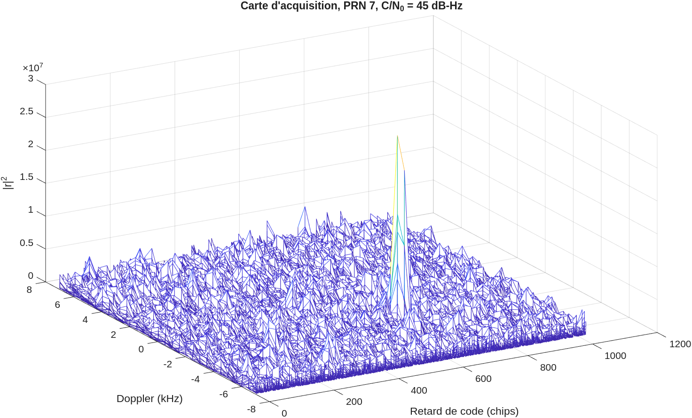
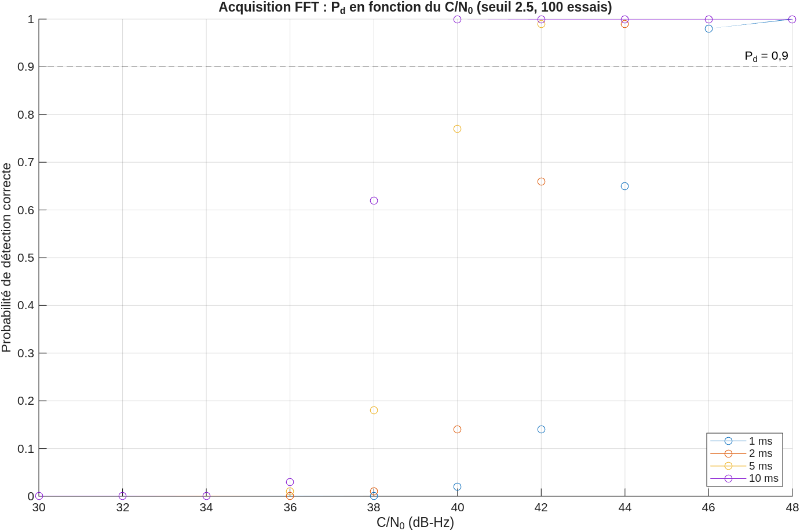

# Acquisition de signaux GPS L1 C/A — Matlab
 
Prototype d'acquisition GNSS : génération du code C/A, simulation du signal reçu,
acquisition par FFT et évaluation des performances par Monte-Carlo.
 
## Contenu
 
| Fichier | Rôle |
|---|---|
| `generer_code_ca.m` | Code C/A GPS (1023 chips) par registres G1/G2, conforme IS-GPS-200 |
| `test_code_ca.m` | Tests unitaires : chips de référence ICD, équilibre, autocorrélation de Gold, intercorrélation |
| `simuler_signal.m` | Signal reçu en bande de base : retard de code, Doppler porteuse et de code, bruit fixé par le C/N0 |
| `acquerir.m` | Acquisition par recherche parallèle en code (FFT), intégration non cohérente sur K ms |
| `etape2_verification.m` | Vérification du simulateur : gain de traitement, sensibilité au Doppler |
| `etape3_acquisition.m` | Recherche des 32 satellites dans un signal contenant le PRN 7 |
| `etape4_performances.m` | Probabilité de détection en fonction du C/N0, fausse alarme, sensibilité |
 
## Méthode
 
Pour chaque case Doppler (−7 à +7 kHz, pas de 500 Hz), la porteuse est retirée puis
la corrélation est calculée pour les 4092 retards à la fois :
 
    r = IFFT( FFT(x · e^(−j2π·fd·t)) · conj(FFT(code local)) )
 
La détection compare le pic principal de la carte |r|² au plus grand pic secondaire
de la même ligne Doppler (hors ±1 chip). Seuil : 2,5.
 
## Résultats
 
**Tests unitaires** : 6/6 réussis.
 
**Acquisition (PRN 7, C/N0 = 45 dB-Hz, 1 ms)** : seul le PRN 7 est détecté parmi les
32 satellites (métrique 6,93 ; maximum des absents 1,93). Erreur de retard 0,20 chip,
erreur Doppler 120 Hz, dans la résolution de la grille (¼ chip, ±250 Hz).
 

 
**Performances (100 essais par point, retard et Doppler aléatoires)**
 
| Intégration non cohérente | C/N0 minimal pour Pd ≥ 0,9 |
|---|---|
| 1 ms | 46 dB-Hz |
| 2 ms | 44 dB-Hz |
| 5 ms | 42 dB-Hz |
| 10 ms | 40 dB-Hz |
 
Probabilité de fausse alarme mesurée : 0/500 sur bruit seul (seuil 2,5).
 
Passer de 1 à 10 ms fait gagner environ 6 dB, et non 10 dB : c'est la perte de
quadrature de l'intégration non cohérente (le module élevé au carré ajoute un terme
bruit × bruit).
 

 
## Limites et suites
 
- Pas de bits de navigation simulés : l'intégration cohérente au-delà de 1 ms
  (limitée par les transitions toutes les 20 ms) n'est pas étudiée.
- Grille Doppler fixe à 500 Hz : un affinage du Doppler après détection améliorerait
  l'estimation.
- Suite prévue : poursuite du code et de la porteuse (DLL, PLL).
## Utilisation
 
```matlab
runtests('test_code_ca')
etape3_acquisition
etape4_performances   % 1 à 3 minutes
```
 
